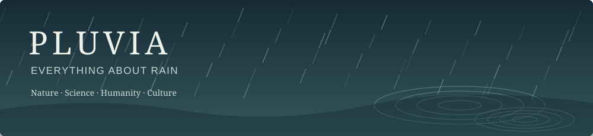

<h1 align="center">Pluvia</h1>

<em>Everything About Rain</em>

An open-ended exploration of rain across nature, science, humanity and culture.

> Rain is the subject. No discipline is off-limits.

Pluvia is an independent, interdisciplinary knowledge and research project. It explores rain from the physics of a falling droplet to the ways people experience, interpret, represent and live with it. It is equally open to mathematical research, anthropology, philosophy, art, history, ecology and everyday observations.

There is no fixed completion date, mandatory product, or publication quota. Follow interesting questions wherever they lead. Research methods should fit the question rather than imposing a single method on every discipline.

## Explore

- [Natural sciences](natural-sciences/README.md)
- [Mathematics and computation](mathematics-and-computation/README.md)
- [Humanities](humanities/README.md)
- [Social sciences](social-sciences/README.md)
- [Arts and culture](arts-and-culture/README.md)
- [Technology](technology/README.md)

Start with the [knowledge index](INDEX.md) or the [open question catalogue](open-questions/README.md). For longer work see [investigations](investigations/README.md), [essays](essays/README.md), [experiments](experiments/README.md) and [references](references/README.md).

**Status:** initial knowledge architecture; questions and directions are proposed, not completed research. English is the default writing language; original-language material is welcome with context and translations when appropriate.

Author: [Gustavo Bernardo Brito](https://github.com/gustavobernardo1).
