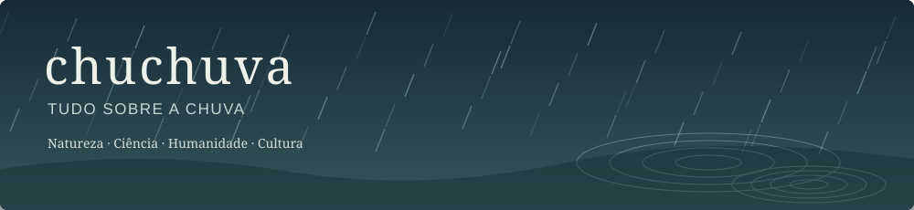

<a href="README.md">English</a> | <strong>Português (Brasil)</strong>

<h1 align="center">chuchuva</h1>

<em>Tudo Sobre a Chuva</em>

Uma exploração aberta da chuva na natureza, ciência, humanidade e cultura.

> A chuva é o objeto de estudo. Nenhuma disciplina está fora dos limites.

chuchuva é um projeto independente e interdisciplinar de conhecimento e pesquisa. Explora a chuva desde a física de uma gota em queda até as formas pelas quais as pessoas a vivenciam, interpretam, representam e convivem com ela. Está igualmente aberto à pesquisa matemática, antropologia, filosofia, arte, história, ecologia e observações cotidianas.

Não há data fixa de conclusão, produto obrigatório ou quota de publicações. Siga perguntas interessantes aonde quer que levem. Os métodos de pesquisa devem se adequar à pergunta, em vez de impor um método único a todas as disciplinas.

## Explore

- [Ciências naturais](natural-sciences/README.md)
- [Matemática e computação](mathematics-and-computation/README.md)
- [Humanidades](humanities/README.md)
- [Ciências sociais](social-sciences/README.md)
- [Artes e cultura](arts-and-culture/README.md)
- [Tecnologia](technology/README.md)

Comece pelo [índice de conhecimentos](INDEX.md) ou pelo [catálogo de perguntas em aberto](open-questions/README.md). Para trabalhos mais extensos, veja [investigações](investigations/README.md), [ensaios](essays/README.md), [experimentos](experiments/README.md) e [referências](references/README.md).

**Estado:** arquitetura inicial de conhecimentos; perguntas e direções propostas, não pesquisas concluídas. O inglês é o idioma padrão de escrita; materiais em sua língua original são bem-vindos, com contexto e traduções quando apropriado.

O nome `pluvia` fica reservado para um possível projeto futuro dentro de chuchuva, sem escopo definido.

Autor: [Gustavo Bernardo Brito](https://github.com/gustavobernardo1).
